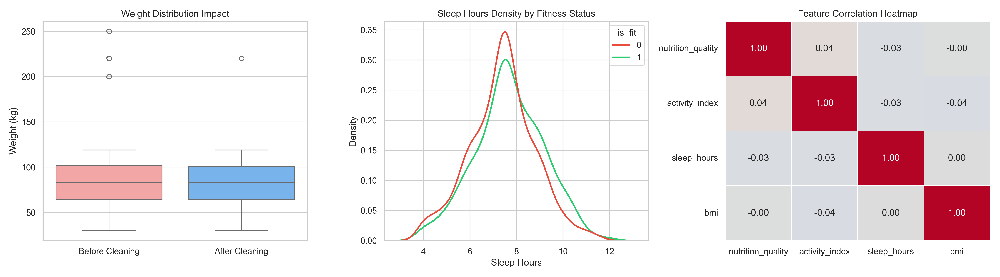

# Fitness Dataset: Data Cleaning

Cleaned a 2,000-row synthetic fitness dataset in a Jupyter notebook: standardized one mixed-type column (`smokes`), filled 156 missing `sleep_hours` values with the median and flagged them, and removed 35 rows with implausible BMI, which are saved in an audit file. The result has 1,965 rows and 13 columns.

## Goal

Clean a messy health and lifestyle dataset with Python (pandas) and document every step and decision, so the result is consistent and can be reproduced.

## Data

- **Source:** [Fitness Classification Dataset (Synthetic)](https://www.kaggle.com/datasets/muhammedderric/fitness-classification-dataset-synthetic) by Mohammed Darrige
- **License:** CC0 (Public Domain)
- **Type:** Synthetic data; no real personal information
- **Size:** 2,000 rows, 11 columns (age, height_cm, weight_kg, heart_rate, blood_pressure, sleep_hours, nutrition_quality, activity_index, smokes, gender, is_fit)

## Data dictionary

| Column                    | Type              | Description                                                                         |
| :------------------------ | :---------------- | :---------------------------------------------------------------------------------- |
| `age`                     | Numeric (int)     | Age of the participant in years.                                                    |
| `height_cm`               | Numeric (int)     | Height of the participant in centimeters.                                           |
| `weight_kg`               | Numeric (int)     | Weight of the participant in kilograms.                                             |
| `heart_rate`              | Numeric (float)   | Resting heart rate in beats per minute (bpm).                                       |
| `blood_pressure`          | Numeric (float)   | Systolic blood pressure in mmHg.                                                    |
| `sleep_hours`             | Numeric (float)   | Average daily sleep duration in hours. Missing values were imputed with the median. |
| `nutrition_quality`       | Numeric (float)   | Rated nutrition quality score (0 to 10 scale).                                      |
| `activity_index`          | Numeric (float)   | Physical activity index level (1 to 5 scale).                                       |
| `smokes`                  | Binary (int)      | Smoking status (standardized: 0 = no, 1 = yes).                                     |
| `gender`                  | Categorical (str) | Participant gender (`'M'` or `'F'`).                                                |
| `is_fit`                  | Binary (int)      | Fitness classification flag (`0` for non-fit, `1` for fit).                         |
| `bmi`                     | Numeric (float)   | Body Mass Index calculated from weight and height.                                  |
| `sleep_hours_was_missing` | Boolean (bool)    | True if `sleep_hours` was missing and imputed.                                      |

## Deliverables

- `fitness_dataset.csv`: Original dataset before cleaning
- `fitness_clean.csv`: Cleaned dataset in CSV format
- `fitness_clean.xlsx`: The same cleaned dataset as an Excel workbook
- `fitness_outliers_removed.csv`: Audit file with the 35 rows removed for implausible BMI
- `data_cleaning.ipynb`: Jupyter Notebook containing code, statistical validation, and documentation
- `quick_insights.png`: Dashboard with three plots: weight before and after cleaning, sleep density by fitness status, and a correlation heatmap
- `requirements.txt`: Pinned package versions used to run the notebook
- `README.md`: Documentation of the problems found, the methodology, and the results

## Problems found

| Column          | Problem                        | How I found it                | Rows affected  |
| --------------- | ------------------------------ | ----------------------------- | -------------- |
| smokes          | Mixed types: 0, 1, "yes", "no" | `.value_counts(dropna=False)` | 1229 (61.45%)  |
| sleep_hours     | Missing values                 | `.isnull().sum()`             | 160 (8.00%)\*  |
| weight_kg & bmi | Extreme values (outliers)      | boxplot, then BMI limits      | 35 (1.75%)\*\* |

_\*Note: 160 missing values were present in the raw dataset. After removing 35 BMI outlier records (which included 4 missing sleep entries), 156 missing values were imputed in the final dataset._
_\*\*Note: A first check flagged 23 rows below 40 kg or above 230 kg. The final rule uses only BMI limits (below 12.0 or above 60.0), which flag 35 rows. Rows just inside the limits are kept, for example 35 kg at 170 cm (BMI 12.11)._

## Checks with no issues

| Column              | Accepted range    | Limit source          | Rows outside the range | Action                                      |
| :------------------ | :---------------- | :-------------------- | :--------------------- | :------------------------------------------ |
| Entire dataset      | No duplicate rows | My judgment           | 0                      | None needed (`.duplicated().sum()`)         |
| `age`               | 10 to 100 years   | My judgment           | 0                      | None needed                                 |
| `height_cm`         | 130 to 230 cm     | My judgment           | 0                      | None needed                                 |
| `sleep_hours`       | 0 to 24 hours     | My judgment           | 0\*                    | None needed                                 |
| `nutrition_quality` | 0 to 10 scale     | Dataset documentation | 0                      | None needed                                 |
| `activity_index`    | 1 to 5 scale      | Dataset documentation | 0                      | None needed                                 |
| `gender`            | `'M'` or `'F'`    | Dataset documentation | 0                      | None needed (`.value_counts(dropna=False)`) |
| `is_fit`            | `0` or `1`        | Dataset documentation | 0                      | None needed (`.value_counts(dropna=False)`) |
| `heart_rate`        | 40 to 200 bpm     | My judgment           | 0                      | None needed (max observed: 118.6)           |
| `blood_pressure`    | 70 to 250 mmHg    | My judgment           | 0                      | None needed                                 |

\*`sleep_hours` was range-checked after the BMI removal (1,965 rows) and before imputation.

## What I did

1. **Standardized `smokes`:** Stripped whitespace, lowercased the text, and mapped every spelling to a binary code (0 = no, 1 = yes).
2. **Checked for duplicates:** 0 duplicate rows found.
3. **Initial data profiling and domain range validation:** Compared every column against its accepted limits. All checks ran on the 2,000 raw rows, except `sleep_hours`, which was checked after the BMI removal and before imputation.
4. **Engineered the `bmi` feature:** Calculated Body Mass Index ($\text{BMI} = \frac{\text{weight\_kg}}{(\text{height\_cm}/100)^2}$) to detect implausible height–weight combinations.
5. **Outlier removal and audit file:** Identified 35 rows with an implausible BMI ($\text{BMI} < 12.0$ or $> 60.0$). These records were exported to `fitness_outliers_removed.csv` for review before being filtered out via a boolean mask, leaving 1,965 rows. The removed share (1.75%) is consistent with the documentation’s note of about 2% weight outliers; this compares only the share, not the specific rows.
6. **Compared imputation methods for `sleep_hours`:** Tested performance by hiding a random 10% of known values across 50 iterations (seeds 0–49) and comparing the global median against a grouped median based on `age_group` (young: 18–25, adult: 26–50, senior: 51–100), `gender`, and `activity_index_group` (low: up to 2.0, medium: above 2.0 up to 4.0, high: above 4.0 up to 5.0).
   - _Result:_ Both methods had a similar mean absolute error (MAE): 1.2010 h (global) and 1.2105 h (grouped). Grouping did not reduce it, and no grouped prediction came back empty.
7. **Imputed missing `sleep_hours` and flagged the filled rows:** Filled missing `sleep_hours` with the global median (7.5 hours) and added the column `sleep_hours_was_missing` (True/False) to mark them.
   - _Count:_ Imputed 156 remaining missing records in the cleaned dataset (4 of the original 160 missing values belonged to the 35 removed BMI outlier rows).

## Before and after

| Metric                         | Before              | After                                       |
| :----------------------------- | :------------------ | :------------------------------------------ |
| Rows                           | 2,000               | 1,965                                       |
| Missing values                 | 160 (8.00% of rows) | 0 (156 imputed after the removal)           |
| Duplicate rows                 | 0                   | 0                                           |
| Columns with mixed types       | 1 (`smokes`)        | 0                                           |
| Columns                        | 11                  | 13 (added `bmi`, `sleep_hours_was_missing`) |
| Rows removed (implausible BMI) | 0                   | 35 (1.75%)                                  |

## Assumptions and questions I would ask a client

- I treated the BMI limits (12.0 to 60.0) as a plausibility filter, not as a clinical cutoff. They are my judgment call.
- I assumed that filling missing `sleep_hours` with the global median is acceptable for a first analysis: it performed about as well as a grouped median in my masking test (step 6).
- Is `smokes` meant to be only yes/no, or should future data collection capture smoking frequency (e.g., occasional vs. daily smoker)?
- Are extreme weight-height combinations caused by manual entry errors or by faulty sensors?
- Which imputation strategy would you prefer for missing sleep values: median filling or model-based prediction?
- Should the 35 extreme BMI records (currently isolated in `fitness_outliers_removed.csv`) be permanently excluded, or would you prefer them retained in the main dataset with a dedicated boolean flag column (e.g., `is_outlier`)?
- Should the final file include age groups and activity levels as derived columns for future dashboards?

## Quick insights



1. **Weight distribution impact:** Removing the 35 implausible BMI outlier records ($\text{BMI} < 12.0$ or $> 60.0$) lowered the maximum weight from 250 kg to 220 kg and the standard deviation from 25.85 kg to 21.75 kg. The middle half of the data remained stable (64–102 kg before, 64–101 kg after), and the minimum stayed at 30 kg. One 220 kg row (199 cm, BMI 55.55) remains because it passes the BMI limits.
2. **Sleep and fitness:** Imputed rows share a single value (the median), creating a prominent peak at about 7.5 hours. Excluding these records smooths the distributions and reveals a visible shift: the fit group (`is_fit = 1`) tends toward longer sleep hours. The curves still overlap heavily; this is a visual check, not a statistical test.
3. **Correlations:** All pairwise correlations between `nutrition_quality`, `activity_index`, `sleep_hours`, and `bmi` are between −0.04 and 0.04, so there is no sign of a linear relationship among them in this synthetic dataset. Leaving out the imputed `sleep_hours` rows changes its correlations with the other three columns by at most 0.002.

## How to run

1. Clone or download this repository.
2. Install the pinned packages, which include the Jupyter kernel (Python 3.10.3 was used):

   ```bash
   pip install -r requirements.txt
   ```

3. Keep `fitness_dataset.csv` (included) in the same folder.
4. Open `data_cleaning.ipynb` in your preferred environment (such as Jupyter Notebook, JupyterLab, or VS Code — note that the first two require installing notebook or jupyterlab separately) and choose **Run All**.

## Limitations

- **Synthetic data:** The data are generated, so the distributions and near-zero correlations may not reflect real-world physiology.
- **Imputation:** Filling missing `sleep_hours` with the global median (7.5 hours) adds an artificial peak at that value. The notebook therefore repeats the sleep plot and the correlations without the imputed rows (see `sleep_hours_was_missing`).
- **BMI filter:** Rows are removed only by the BMI limits (below 12.0 or above 60.0), not by clinical review. Extreme rows just inside the limits are kept, for example 35 kg at 170 cm (BMI 12.11).

## Tools

- Python (3.10.3): Core programming environment.
- pandas and NumPy: Data cleaning, range checks, group analysis, and statistical summaries.
- Matplotlib and seaborn: Distribution plotting and correlation visualization.
- openpyxl: Excel file export support.
- Jupyter notebook (.ipynb), run in VS Code with ipykernel: interactive execution and documentation.
